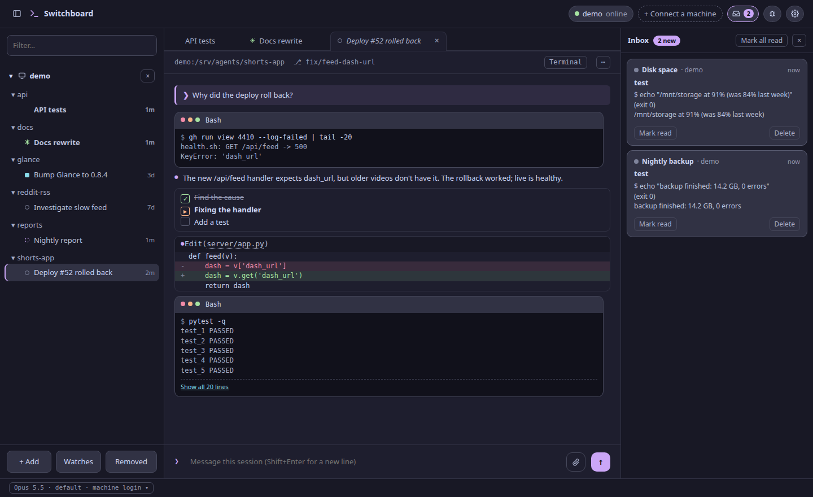
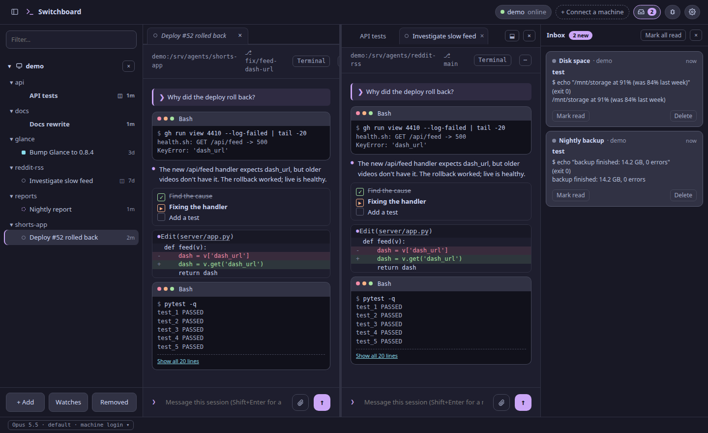
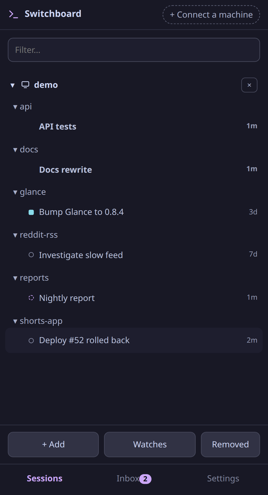
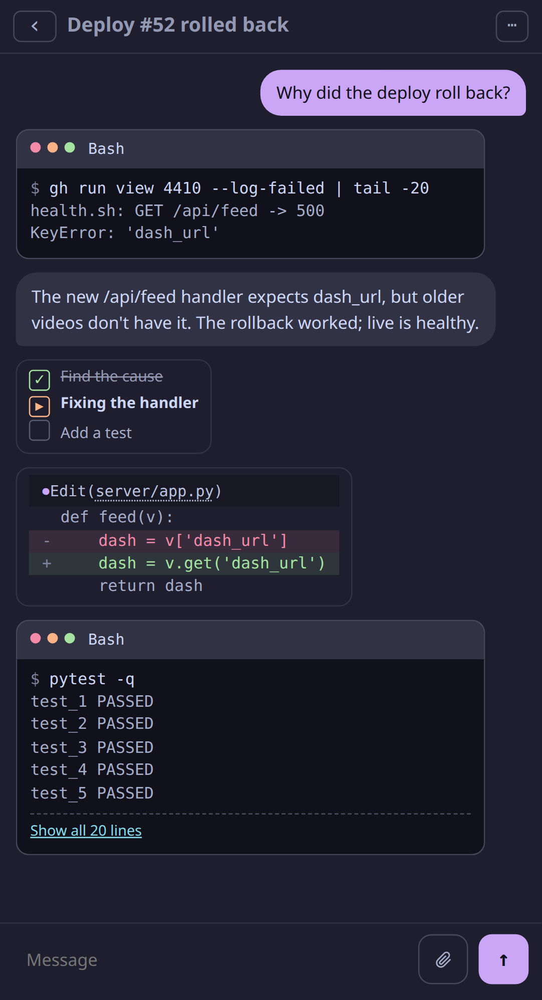
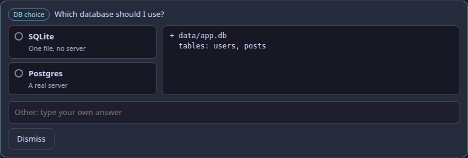

<div align="center">

# Switchboard

**All your Claude Code sessions, on every machine, in one place.**

Run Claude Code on your PC, your server and your work laptop, and drive them all from one desktop app or your phone.
Sessions keep working while you're away; agents can wake themselves, message each other, and tell you when they need you.

[Download](https://github.com/cyaninc-lab/switchboard/releases/latest) · [What's new](https://github.com/cyaninc-lab/switchboard/releases) · [Protocol](docs/protocol.md)



</div>

## Why

Claude Code lives in one terminal on one machine. Once you have a few sessions going (a deploy on the server, a refactor
on your PC, a report on the work laptop) you spend your time hunting for terminals. Switchboard gives every session a
place in one list, with the ones that need you at the top, and lets you answer from wherever you are.

It's the same Claude Code underneath: the same models, tools, permission modes, skills, slash commands and
`CLAUDE.md`. Switchboard adds the remote control, never a different agent.

## What it does

**Every session, every machine**
- One tree of sessions across all your machines, grouped by project. Stopped sessions stay listed and resume with your next message.
- Tabs, a split view with its own tabs (drag tabs between them), and pop-out windows.
- Quick filters: replied in the last hour / day / week, waiting on you, working, unread, pinned.
- Add an existing session from its folder, its name, or a pasted `claude --resume <id>`.

**A chat that keeps up**
- Streaming replies, thinking, subagents (running ones nest under their session), diffs, to-do lists, and command output that folds to six lines.
- Questions and plan approvals as cards; permission requests with Allow once / for this session / always.
- Messages you send while Claude works go in at its next step, like Claude Code. Take one back with ✕, pull it up to edit with ↑, or send it now with Ctrl+Enter.
- Attach pictures or any file (it lands on the session's machine), or drop files anywhere on the chat.
- Per-session model, effort, permission mode and Claude account; per-project defaults.
- Your plan's 5-hour and weekly use, and each session's context and cost, in the status bar.

**Agents that work while you don't**
- **Watches** check things on a schedule (once, daily, every N minutes), run a command, watch a URL or a GitHub repo, and either tell you or wake an agent with instructions.
- Agents can set up, edit and pause their own watches, leave you a note in the **inbox**, or **phone you** when something can't wait.
- Sessions **message each other**, on the same machine or across machines, and you see the conversation in a side panel.

**On your phone**
- An Android app with the same sessions, chat, questions and approvals.
- Notifications when a session finishes, asks something or needs permission: answer from the notification.
- Calls: an agent rings you and you talk it through.



<p align="center">
  
  &nbsp;
  
  &nbsp;
  
</p>

## How it works

```
 desktop app ─┐                    ┌─ daemon on your PC ──── Claude Code sessions
 phone app ───┼── paired devices ──┼─ daemon on a server ─── Claude Code sessions
 browser ─────┘                    └─ daemon at work ─────── Claude Code sessions
```

- A small **daemon** on each machine (Python, the [Claude Agent SDK](https://docs.claude.com/en/docs/agent-sdk/overview))
  owns that machine's sessions. It runs inside the desktop app, or on its own as a background service on a machine
  with no screen.
- The **apps** (desktop for Linux and Windows, Android, or a plain browser) connect to any number of daemons. Each
  device is paired once, with a one-time code or a QR code.
- Sessions stay on their own machine, with that machine's files, tools and Claude login. Nothing is copied anywhere else.

## Install

**Desktop (Linux, Windows).** Download the AppImage, `.deb` or Windows installer from the
[latest release](https://github.com/cyaninc-lab/switchboard/releases/latest). The app runs its own daemon and updates
itself. Claude Code must be installed and signed in on that machine.

**A machine with no screen (a server).** Install the daemon with pip and run it as a service:

```sh
python3 -m venv ~/switchboard/venv
~/switchboard/venv/bin/pip install "switchboard-daemon @ https://github.com/cyaninc-lab/switchboard/archive/refs/tags/v0.1.42.tar.gz#subdirectory=daemon"
~/switchboard/venv/bin/switchboard-daemon serve --host <its private address> --auto-update   # e.g. its Tailscale IP
~/switchboard/venv/bin/switchboard-daemon pair     # prints a one-time code for "+ Connect a machine" in the app
```

`--auto-update` installs new releases by itself when no session is busy (run it under systemd with `Restart=always`).

**Phone (Android).** Install `Switchboard.apk` from the latest release, then pair it from the desktop app (click a
machine → Pair another device) by scanning the QR code. The app updates itself.

> Daemons have no TLS of their own: reach them over a private network such as [Tailscale](https://tailscale.com), never
> the open internet.

## Building and contributing

- `daemon/`: the Python daemon (`pip install -e "./daemon[test]"`, then `pytest daemon/tests`; `switchboard-daemon serve --demo` serves scripted sessions without using Claude).
- `desktop/`: the Tauri 2 + Svelte 5 app, which is also the phone app and the web UI (`npm run tauri dev`; UI tests: `npx playwright test`).
- [`docs/protocol.md`](docs/protocol.md): the daemon's API. [`CLAUDE.md`](CLAUDE.md) and [`docs/HANDOVER.md`](docs/HANDOVER.md): how the project is worked on.

Bug reports are welcome: the app's **Report a bug** button opens a pre-filled issue with scrubbed logs.

## Licence

[AGPL-3.0](LICENSE): free to use, change and share. If you run a modified version for others to use over a network,
share your changes too.
